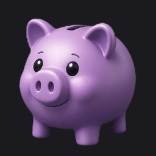
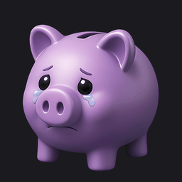
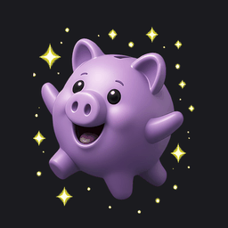
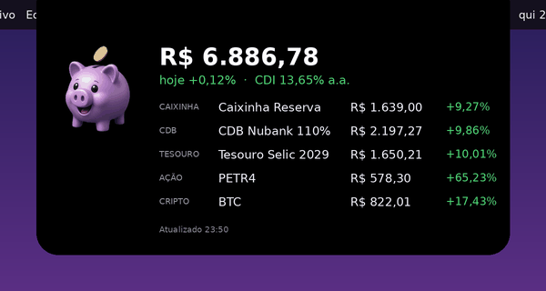
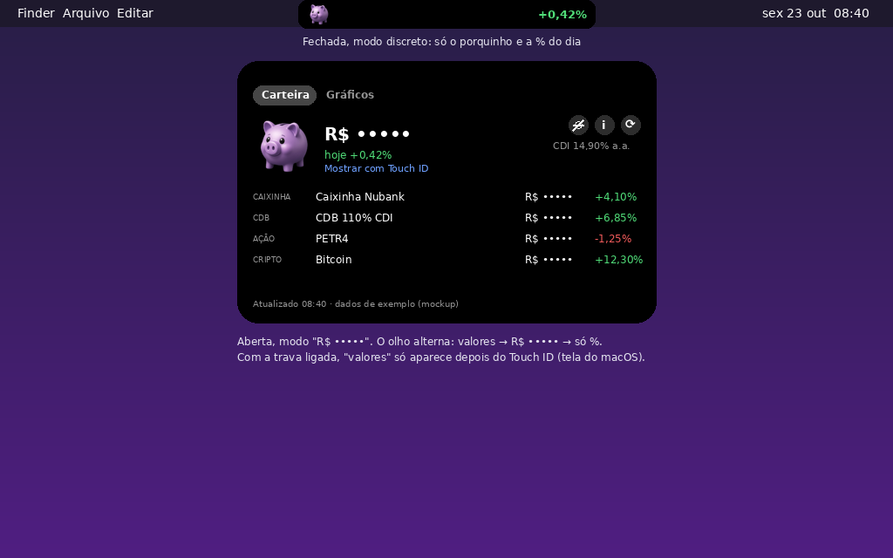
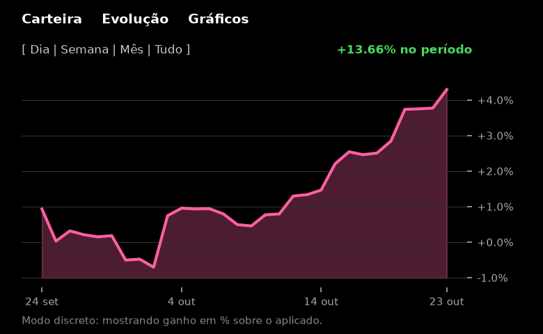
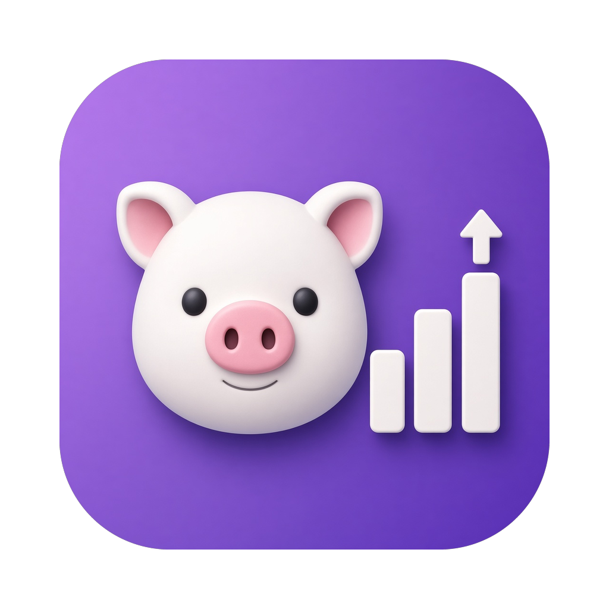

# 🐷 Pilinha

> **Seus investimentos morando no entalhe do Mac, cuidados pela Pilinha, um porquinho que sorri quando o dinheiro rende.**

App de entalhe (notch) do Mac para acompanhar investimentos: renda fixa pelo CDI, ações e FIIs da B3 e bitcoin, tudo
numa ilhazinha preta em volta da câmera. **Só leitura, sem banco, dados só no seu Mac.**

> 🐷 **Pilinha** é o nome do app *e* do porquinho que mora no entalhe — "pila" é gíria gaúcha pra dinheiro, e a Pilinha é quem
> cuida das suas pilas. (O repositório e o código continuam como `notch-invest`/`NotchInvest*` por compatibilidade.)

<p align="center">
  
  
  
  
  
  
</p>

| Ilha fechada | Ilha aberta |
|:---:|:---:|
|  |  |

| Aba Gráficos (TradingView) | Modo discreto |
|:---:|:---:|
|  |  |

| Aba Evolução (histórico local) | Ícone |
|:---:|:---:|
|  |  |

<sub>Imagens com dados de exemplo (mockups).</sub>

---

## ✨ Recursos
- 🏝️ **Ilha no entalhe:** fica fechada (porquinho + total + % do dia). Clique para abrir; fecha com outro clique, clique fora ou `Esc`.
- 💰 **Carteira:** caixinhas, CDB, Tesouro Selic, LCI/LCA (% do CDI), ações e FIIs (B3) e cripto em reais.
- 🔄 **Atualização automática** a cada 5 minutos, mais o botão ⟳.
- 📈 **Aba Gráficos:** o TradingView oficial num painel maior (720×460), com o login salvo, os seus layouts e uma troca rápida de ativo.
- 🙈 **Modo discreto:** valores → `R$ •••••` → só porcentagens. Vem ligado na primeira vez.
- 👆 **Trava com Touch ID** (opcional, com a senha do Mac como alternativa): os valores voltam a ser escondidos depois de X minutos ou quando o Mac bloqueia.
- 🧾 **Cadastro sem JSON:** janela "Cadastro da carteira" (botão ✎ na ilha ou menu ▸ *Cadastrar carteira…*, `⌘,`) para adicionar, editar e remover renda fixa, ações/FIIs, cripto e proventos. Aceita `1.234,56`, `1234,56` ou `1234.56` e avisa o que está errado antes de salvar.
- 📉 **Aba Evolução:** um ponto por dia do patrimônio em `~/.notchinvest/history.json`, com gráfico Swift Charts (Dia / Semana / Mês / Tudo). No modo discreto o eixo mostra só ganho em %.
- 🧮 **Bruto × líquido:** IR regressivo (22,5% até 180 dias → 20% até 360 → 17,5% até 720 → 15%) e IOF nos primeiros 30 dias, aporte por aporte. LCI/LCA isentas.
- 🌿 **Proventos:** dividendos/rendimentos dos últimos 12 meses pela brapi (estimativa com a quantidade atual) ou lançados à mão (o manual vale no lugar da brapi).
- 🔑 **Token da brapi no Keychain**, digitado no cadastro; nunca no JSON nem em log.
- 🛡️ **Tela "O que este app faz"**, com botões para abrir a pasta dos dados e apagar tudo.
- 🖥️ **Sem entalhe?** Em monitor externo, ela vira uma pílula sob a barra de menus.

## 🐷 Humores do porquinho
| Humor | Quando | Prévia |
|---|---|:---:|
| 😊 Feliz | carteira subiu mais de 0,05% no dia |  |
| 😐 Neutro | variação entre −0,05% e +0,05% |  |
| 😢 Triste | caiu mais de 0,05% no dia |  |
| 😴 Dormindo | buscando cotações |  |
| 🎉 Ganhou | uma vez, quando o total sobe num dia positivo |  |
| 😵 Erro | sem dados / sem arquivo |  |

## 🔒 Privacidade em primeiro lugar
> [!IMPORTANT]
> - **Só leitura:** o app mostra números. Não faz Pix, transferência, compra nem venda.
> - **Sem banco:** não acessa banco nem Nubank, não pede senha de banco e não usa Open Finance (e não vai usar).
> - **Dados locais:** a carteira e o histórico ficam só em `~/.notchinvest/portfolio.json` e `history.json`, com permissão `600` (só a sua conta lê). O token da brapi fica no Keychain.
> - **Sem conta e sem rastreamento:** nenhum login no app, nenhuma estatística de uso.

**O que sai do Mac (verificado no código e nos testes):** todas as consultas passam por `fetchData`, e as URLs são montadas só em:

| Para quê | Site | O que é enviado |
|---|---|---|
| Taxa do CDI | `api.bcb.gov.br` (série SGS 12) | só um intervalo de datas |
| Cotações e proventos B3 | `brapi.dev` | só o código público, ex. `PETR4?dividends=true` (+ seu token no cabeçalho, se cadastrado) |
| Bitcoin em R$ | `api.coingecko.com` | só o id público, ex. `bitcoin` |
| Gráficos | `tradingview.com` | só se você abrir a aba; a URL leva só o símbolo |

Valores, quantidades, preço médio, nomes dos investimentos e o seu nome **nunca** saem do Mac.
O teste `PrivacyTests.testRequestsCarryOnlyPublicTickers` (via `NetworkAudit`) confirma isso.

<p align="center"></p>

## 🚀 Instalação no Mac
Requisitos: macOS 14+ e **só as Command Line Tools** (`xcode-select --install`, Swift 6). Xcode não é necessário.
```bash
git clone https://github.com/pamteech/pilinha.git && cd notch-invest
./Support/build-app.sh --install     # compila em release, monta Pilinha.app, copia para ~/Applications e liga o LaunchAgent
```
Pronto: o porquinho aparece no entalhe e volta sozinho depois de reiniciar o Mac. Na primeira vez, clique em **Cadastrar**
(ou ✎) e preencha a carteira.

Sem instalar: `./Support/build-app.sh` gera `build/Pilinha.app` (abra com `open build/Pilinha.app`).
Para desenvolver: `swift run NotchInvestApp`. Para conferir os cálculos no terminal: `swift run notch-invest-cli portfolio.example.json`.

### Atualizar
```bash
cd notch-invest && git pull && ./Support/build-app.sh --install
```
> Como a assinatura é ad-hoc, depois de recompilar o macOS pode perguntar uma vez se o Pilinha pode ler o token
> no Keychain: clique em **Permitir sempre**.

### Testes
O núcleo usa **swift-testing** (`import Testing`), que vem com o Swift 6 das Command Line Tools — não precisa de XCTest/Xcode:
```bash
swift test --disable-xctest
```
Se as Command Line Tools forem antigas (Swift 5.x) e o `swift test` reclamar de `Testing`, atualize com
`softwareupdate --list` ou rode os testes no Xcode. No Linux: `swift test`.

### Iniciar junto com o Mac (LaunchAgent)
O `--install` cria `~/Library/LaunchAgents/com.pamtech.pilinha.plist` apontando para
`~/Applications/Pilinha.app/Contents/MacOS/Pilinha` (RunAtLoad, reabre se travar, log em `~/.notchinvest/app.log`).
Se existir a instalação antiga (`NotchInvest.app` / `com.pamtech.notchinvest`), o `--install` remove ela sozinho. Os dados continuam em `~/.notchinvest`.
```bash
launchctl bootout   gui/$(id -u) ~/Library/LaunchAgents/com.pamtech.pilinha.plist   # desligar
launchctl bootstrap gui/$(id -u) ~/Library/LaunchAgents/com.pamtech.pilinha.plist   # ligar de novo
```

### Ícone
`Support/AppIcon.icns` é gerado do próprio sprite do porquinho: `python3 Support/make-icon.py` (Pillow).

## 📝 O `portfolio.json` (para quem prefere editar à mão)
```json
{
  "owner": "eu",
  "fixedIncome": [
    { "name": "Caixinha Reserva", "kind": "caixinha", "cdiPercent": 100,
      "deposits": [ { "date": "2026-01-05", "amount": 1000 }, { "date": "2026-06-01", "amount": 500 } ] },
    { "name": "CDB 110%", "kind": "cdb", "cdiPercent": 110,
      "deposits": [ { "date": "2026-03-02", "amount": 2000 } ] }
  ],
  "stocks": [ { "ticker": "PETR4", "quantity": 10, "averagePrice": 35.0 } ],
  "crypto": [ { "coinId": "bitcoin", "symbol": "BTC", "quantity": 0.002, "averagePriceBRL": 350000 } ],
  "manualDividends": [ { "ticker": "MXRF11", "date": "2026-10-15", "amount": 9.80 } ],
  "tradingview": { "layoutURL": "https://www.tradingview.com/chart/", "panelWidth": 720, "panelHeight": 460 }
}
```
- `kind`: `caixinha`, `cdb`, `tesouro`, `lci` ou `lca`. `cdiPercent: 110` significa 110% do CDI. Cada aporte tem data e valor.
- O CDI rende por dia útil: saldo × Π(1 + taxa do dia × %CDI). O valor líquido desconta IOF (até 30 dias) e IR regressivo de cada aporte; `lci`/`lca` são isentas (a custódia da B3 no Tesouro não entra).
- `averagePrice` e `averagePriceBRL` são opcionais e servem para calcular o ganho em %.
- `manualDividends` (opcional): proventos que caíram na conta; para aquele ticker, substituem a estimativa da brapi.
- O token da brapi **não** fica aqui: vai no Keychain pela tela de cadastro (ou `export BRAPI_TOKEN=...` no CLI).
- `coinId` é o id do CoinGecko (`bitcoin`, `ethereum`...).

## 📊 TradingView (aba Gráficos)
- Abre o site oficial (`/chart/` ou o seu layout salvo). O login fica salvo no armazenamento do próprio WebKit; o app nunca vê a senha.
- ⚠️ **Entre com e-mail e senha, não com o Google.** O Google bloqueia login em navegadores embutidos (`403 disallowed_useragent`).
  Se a sua conta foi criada pelo Google, defina uma senha no perfil do TradingView, ou use o botão **Abrir no navegador**.
- **Widget sem login:** alterna para o widget gratuito "Advanced Real-Time Chart" (com a atribuição do TradingView).
- Tickers da carteira: `BMFBOVESPA:PETR4`, `BINANCE:BTCBRL`. Dá para trocar em `tradingview.symbols`.
- Config: `layoutURL`, `layouts` (`[{ "name", "url" }]`), `panelWidth`, `panelHeight`, `symbols`, `preferWidget`.
- Uso pessoal, só para ver os gráficos, conforme os termos do TradingView. Nada de raspagem nem automação.
- O `Esc` fecha a ilha mesmo com o foco no gráfico. Para cancelar um desenho, use o clique direito.
- Para um build com App Sandbox, use `Support/NotchInvest.entitlements` (`network.client`).

## 🗂️ Estrutura
```
Sources/
  NotchInvestCore/   modelo, CDI, IR/IOF, proventos, histórico, validação do cadastro, cotações (BCB, brapi, CoinGecko),
                     humores, privacidade, TradingView — multiplataforma e testado
  NotchInvestApp/    app SwiftUI/AppKit: janela no entalhe, ilha, abas, gráficos, modo discreto/Touch ID, menu
    Resources/Cofrinho/   folhas de animação do porquinho (128 px e @2x, 24 fps)
  notch-invest-cli/  CLI para conferir os cálculos
Tests/NotchInvestCoreTests/   testes do núcleo (swift-testing)
Support/             build-app.sh (gera o .app), make-icon.py + AppIcon.icns, entitlements (só para build com sandbox)
personagem/opcao2d/  arte do porquinho: folha_ia.jpg + anima2d.py (gera frames, folhas e GIFs) + prévias
previews/            GIFs e mockups do README
docs/                notas de arquitetura
```
Para regenerar o porquinho: `cd personagem/opcao2d && python anima2d.py` (Pillow e NumPy), depois `pngquant` nas folhas.

## 🛣️ Roadmap
- [ ] 🔔 Alertas (ativo subiu ou caiu X%, CDI mudou)
- [x] 🧾 Tela de cadastro (sem editar JSON)
- [x] 📉 Gráfico da evolução da carteira
- [x] 💸 Proventos (brapi + lançamento manual)
- [x] 🧮 Valor líquido (IR regressivo, IOF, isenção de LCI/LCA)
- [x] 📦 Pilinha.app com ícone próprio, só com Command Line Tools
- [ ] 🎯 Metas (ex. reserva de emergência) com progresso no porquinho
- [ ] 🧾 IR sobre ações/cripto na venda e JCP líquido

## 🙏 Créditos
- Feito por **Pam Tech**.
- A técnica de janela no entalhe foi **inspirada no [Coucou](https://github.com/Louis-CFM/coucou) (licença MIT)**, reescrita do zero
  (veja `NOTICE`). **Este projeto não usa o nome Coucou, o personagem Mochi, ícones, sons nem nenhum outro asset dele.**
- Porquinho original deste projeto. Dados públicos: Banco Central do Brasil (SGS), brapi.dev, CoinGecko. Gráficos: TradingView.

## 📄 Licença
[MIT](LICENSE) © 2026 Pam Tech
